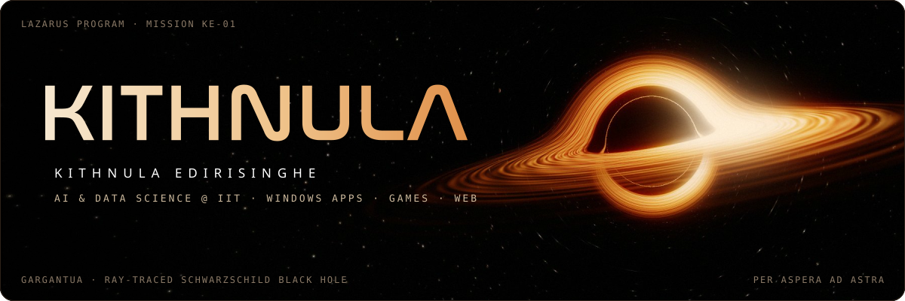
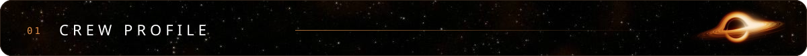
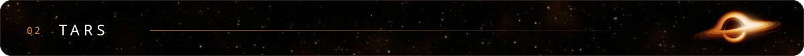
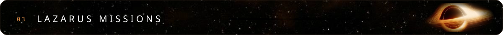
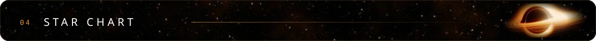
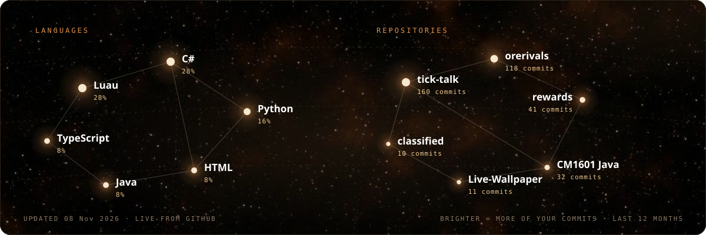
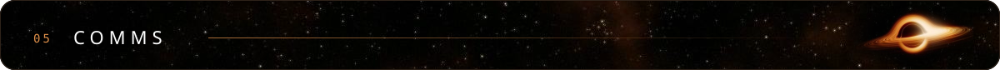

### Hey, I'm Kithnula.

AI & Data Science undergrad at **IIT**. I build Windows apps, games and things for the web, and spend the rest of my time learning about stars, galaxies and black holes.

- **Current mission:** building a Roblox game
- **Propulsion:** C#, Python, TypeScript, Luau, Java
- **Ask me about:** Windows desktop apps, Roblox game dev, or what's in the night sky this week

**Crew missions**, built with friends:

| Mission | Stack | Crew |
| :-- | :-- | :-- |
| [**Live-Wallpaper**](https://github.com/Hirukadeven07/Live-Wallpaper) | HTML · JS | [@Hirukadeven07](https://github.com/Hirukadeven07) |
| **Tick-Talk** private | C# | [@niamatmarjan](https://github.com/niamatmarjan) |
| **OreRivals** private | Luau · Roblox | [@niamatmarjan](https://github.com/niamatmarjan) |
| **Rewards** private | TypeScript | [@thahaniazmi](https://github.com/thahaniazmi) |

Open a channel. I'm always up for talking code, game dev or the night sky.

  
  
  

Telemetry, TARS's briefing and the star chart update every 3 hours · Per aspera ad astra

